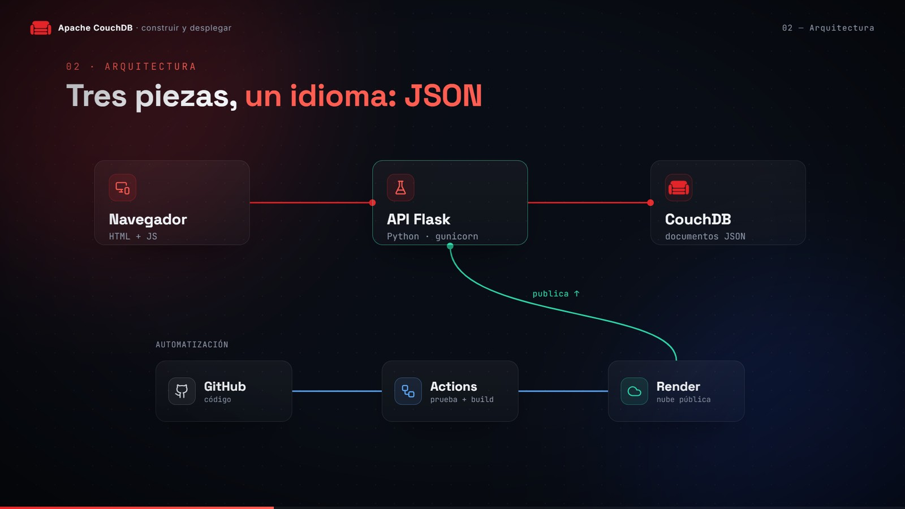

# Tablero de tareas con Apache CouchDB

App de demostración Flask + **Apache CouchDB** (base de datos NoSQL orientada a documentos): tablero Kanban cuyas tareas son documentos JSON consultados con Mango (`_find`). Empaquetada con Docker, probada y desplegada automáticamente con GitHub Actions en Render, donde tanto la app como CouchDB corren como servicios del mismo Blueprint.

- App en vivo: https://nosql-couchdb-app.onrender.com (plan gratuito: el primer acceso tras un rato inactivo tarda ~1 min)
- Base de datos NoSQL: CouchDB (sin Redis, MongoDB, Neo4j ni Prometheus)



## Ejecutar en local

```bash
docker compose up -d --build
# la primera petición crea la base y la rellena con 5 tareas de ejemplo
# abrir http://localhost:8000   (Fauxton, el panel de CouchDB: http://localhost:5984/_utils, usuario admin / change-me)
```

## API

| Método | Ruta | Descripción |
|---|---|---|
| GET | `/health` | comprueba la conexión con CouchDB |
| GET | `/api/tasks?status=&tag=` | lista tareas (consulta Mango en el servidor) |
| POST | `/api/tasks` | crea `{ "title": "...", "tags": ["..."] }` |
| PATCH | `/api/tasks/<id>` | cambia el estado `{ "status": "todo\|doing\|done" }` |
| DELETE | `/api/tasks/<id>` | borra una tarea |
| GET | `/api/stats` | conteo por estado |

Variables de entorno: ver `.env.example`.

## Pruebas

```bash
pip install -r requirements-dev.txt
python -m pytest -q                       # unitarias (sin base de datos)
COUCHDB_URL=http://localhost:5984 COUCHDB_USER=admin COUCHDB_PASSWORD=change-me python -m pytest -q   # + integración real
```

## Despliegue automatizado

`.github/workflows/ci-cd.yml` en cada push / PR:

1. **test**: pytest con un contenedor CouchDB real como servicio.
2. **docker**: `docker compose up --wait`, siembra datos y comprueba `/health` y `/api/stats`.
3. **deploy** (solo `main`): llama al *Deploy Hook* de Render y espera a que `/health` responda en la URL pública.

Secreto de GitHub requerido: `RENDER_DEPLOY_HOOK_URL`. Variable (Settings → Variables): `APP_URL`.

### Puesta en marcha en la nube

1. En Render: **New → Blueprint** con este repositorio. `render.yaml` crea dos servicios: `couchdb` (imagen oficial `couchdb:3.3`, contraseña generada) y `nosql-couchdb-app` (la app). El usuario y la contraseña pasan solos de un servicio al otro (`fromService`).
2. Render pide `COUCHDB_URL`: pon la URL pública del servicio `couchdb` (`https://couchdb-xxxx.onrender.com`). No se usa la red privada porque en el plan gratuito un servicio no recibe tráfico privado; CouchDB queda protegido con usuario y contraseña. Si la creaste antes de saberla, edítala en *Environment* y elige *Save and deploy*.
3. Copiar el *Deploy Hook* del servicio `nosql-couchdb-app` como secreto `RENDER_DEPLOY_HOOK_URL` y su URL pública como variable `APP_URL`.

### Datos en el plan gratuito (no persistentes, pero la demo lo parece)

Render no ofrece disco persistente gratis, así que los datos de CouchDB se pierden cuando el servicio se reinicia. Para que la demo nunca se vea rota:

- **Siembra automática:** cuando la app **crea** la base (primer arranque o tras perderse), la rellena con 5 tareas de ejemplo (`DEMO_TASKS` en `app/couch.py`). Solo se siembra al crear la base, no cuando queda vacía, para no resucitar tareas que el usuario borró. Con varios workers solo uno obtiene el `201` de CouchDB, así que no se duplica. Se desactiva con `SEED_DEMO=false`.
- **Recuperación:** si la base desaparece con la app en marcha, el cliente la recrea (con su índice y datos de ejemplo) y reintenta la petición.
- **Base dormida:** la API responde `503` y la interfaz muestra "Despertando la base de datos…" y reintenta sola cada 5 s, en lugar de un error.
- **Keepalive (opcional):** `.github/workflows/keepalive.yml` hace ping a `/health` cada 10 min para evitar que los servicios se duerman. Está apagado por defecto: actívalo creando la variable de GitHub `KEEPALIVE=true` antes de una demo o calificación y desactívalo después, porque el plan gratuito de Render tiene un límite mensual de horas de instancia (según la política que conozco, 750 h compartidas; verifícalo en Render) y dos servicios despiertos 24/7 pueden agotarlo.

Lo que los usuarios añadan sí se pierde al reiniciar. Para conservar datos, usa un plan de pago con disco montado en `/opt/couchdb/data`.
